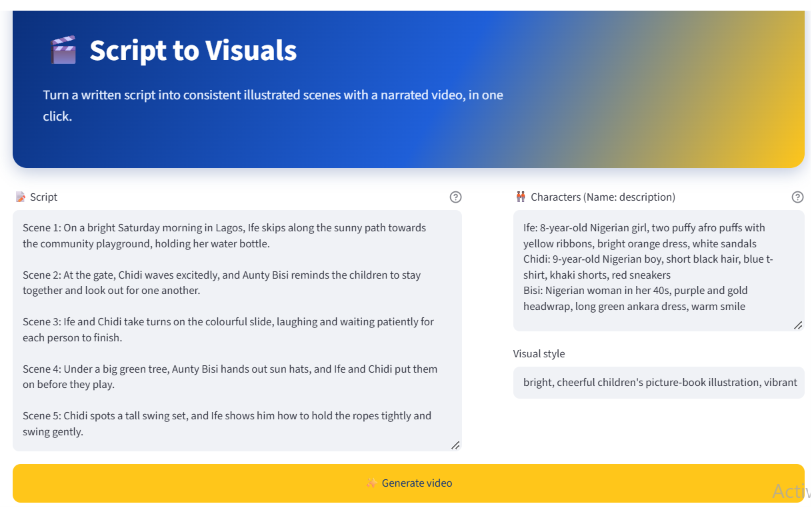
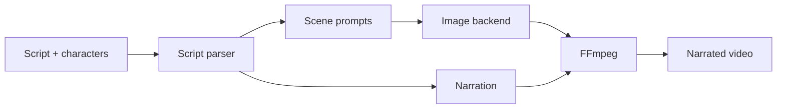
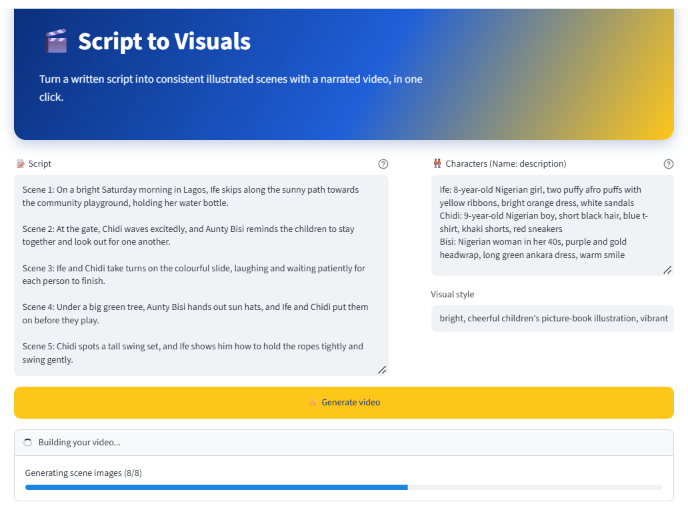
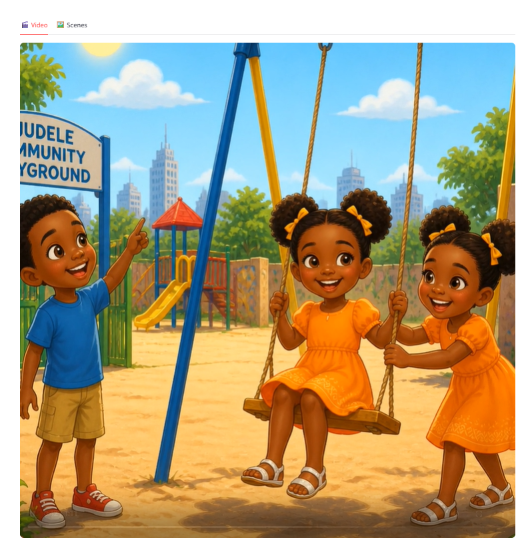

# 🎬 Script to Visuals

Paste a script, describe your characters once, and get back illustrated scenes and a narrated video. 



## Why I made this

Making a short illustrated video usually means juggling an image generator, a voice-over tool and a video editor. The hardest part is keeping characters looking the same from one picture to the next. This project handles all of it in one place: you write the script and describe who is in it, and the app keeps those descriptions attached to every scene it draws.

I built it around short educational stories set in Nigeria, so the characters, settings and narration style lean that way, but nothing stops you from using it for any story.

## How it works



1. **Parse.** The script is split into scenes. Each scene is matched against your character list to see who appears in it.
2. **Prompt.** For every scene, the app builds an image prompt that combines the action, the full description of each character present, and your chosen visual style. Repeating the character descriptions in every prompt is what keeps them looking consistent.
3. **Draw.** Images come from either the OpenAI image API or a local ComfyUI setup, depending on which backend you pick.
4. **Narrate.** Each scene's text is turned into spoken narration in a Nigerian-English style.
5. **Assemble.** FFmpeg joins the images and audio into one video, timing each image to its narration.

## Using it

You give the app three things:

| Field | What to put in it |
|---|---|
| **Script** | The story, written as `Scene 1: ...`, `Scene 2: ...` and so on |
| **Characters** | One per line, as `Name: description`. Be specific about age, hair, clothes and colours |
| **Visual style** | A short phrase for the look, e.g. *bright, cheerful children's picture-book illustration* |

Example characters:

```
Ife: 8-year-old Nigerian girl, two puffy afro puffs with yellow ribbons, bright orange dress, white sandals
Chidi: 9-year-old Nigerian boy, short black hair, blue t-shirt, khaki shorts, red sneakers
Bisi: Nigerian woman in her 40s, purple and gold headwrap, long green ankara dress, warm smile
```

The more concrete the description, the better the characters hold together. "Blue t-shirt, khaki shorts, red sneakers" works far better than "a normal boy".

Press **Generate video** and a progress bar tracks the images as they come in:



When it finishes, the video shows up in the **Video** tab, with every scene also available in the **Scenes** tab:



## Setup

### Requirements

- Python 3.10 or newer
- [FFmpeg](https://ffmpeg.org/download.html), with both `ffmpeg` and `ffprobe` on your PATH
- An OpenAI API key (for narration, and for images unless you use ComfyUI)
- Optional: a running [ComfyUI](https://github.com/comfyanonymous/ComfyUI) install if you want local image generation


## Project layout

```
.
├── app.py                 # Streamlit UI
├── pipeline/
│   ├── script_parser.py   # splits the script into scenes, finds characters
│   ├── backends.py        # OpenAI and ComfyUI image backends
│   ├── narration.py       # text-to-speech
│   ├── video.py           # FFmpeg assembly
│   └── runner.py          # runs the steps in order
├── tests/                 # pytest suite
├── docs/screenshots/      # images used in this README
└── requirements.txt
```

Run the tests with:

```bash
pytest
```

## Things worth knowing

- **Consistency is good, not perfect.** The model can still drift on small details, and occasionally it will draw a character twice in one frame or swap an outfit. If a scene comes out wrong, tightening the character description or simplifying the scene text usually fixes it on the next run.
- **Keep scenes simple.** One clear action per scene gives the best pictures and the cleanest narration.
- **Runs take a while.** Each scene needs an image and an audio clip, so a longer script means a few minutes of waiting and some API cost.
- **If the video step fails immediately,** run `ffmpeg -version` and `ffprobe -version` in your terminal. If either is missing, that's the problem.

## Ideas for later

- Per-scene regenerate button, so one bad image doesn't mean redoing everything
- Choice of narrator voice
- Background music and simple transitions
- Export of the images and audio as separate files

## Related

There's also a newer version, [Story to Video](https://github.com/Jaycobson/GenAI-image-Video-scripts), where you give it a one-line idea instead of a full script and a model plans the scenes for you.

## Contributing

Issues and pull requests are welcome. Please run `pytest` before opening a PR.
